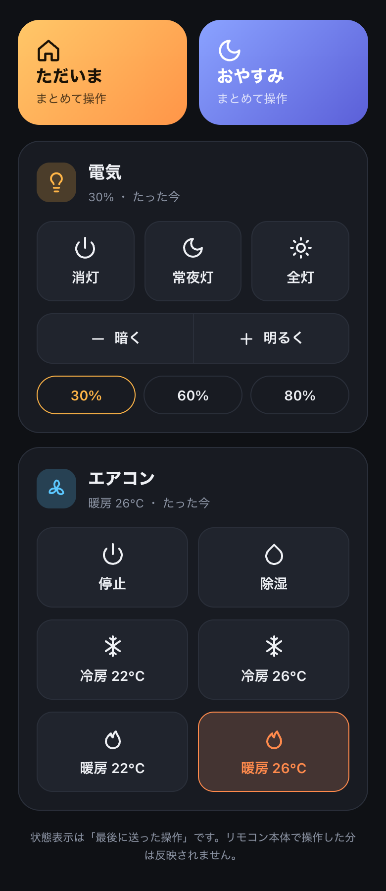

# SmartRoom

Raspberry Pi と赤外線LEDで、部屋の照明やエアコンをスマホのブラウザから操作する Web リモコンです。
手持ちのリモコンの信号を学習させて使うので、メーカーを問わず赤外線リモコンで動く家電なら操作できます。



## 特徴

- **ブラウザだけで操作**：アプリのインストール不要。スマホで「ホーム画面に追加」すればアプリのように使えます
- **設定ファイルでボタンを定義**：`config.yaml` を書き換えるだけで、ボタンや機器を追加できます（UI は自動生成）
- **シーン**：「ただいま」「おやすみ」のように、複数の操作をまとめて1タップで送信
- **ダーク / ライト両対応**、外部 CDN 依存なし（インターネット接続のない LAN でも動作）
- **軽量**：FastAPI + [pigpio](https://abyz.me.uk/rpi/pigpio/)。赤外線の送信は pigpio のハードウェアタイミングで正確に行います

## 構成

```
スマホ / PC ──(LAN または Tailscale などの VPN)──> uvicorn :3000
                                                     └─ pigpiod ──> GPIO ──> 赤外線LED ──> 家電
```

## 必要なもの

| 種類 | 例 | 備考 |
|---|---|---|
| Raspberry Pi | Pi 3 / 4 / Zero 2 W など | **Pi 5 は pigpio 非対応のため使えません** |
| OS | Raspberry Pi OS (Bookworm / Bullseye) | Python 3.9 以上 |
| 赤外線LED | 940nm の赤外線LED | 届く距離を伸ばすならトランジスタで駆動 |
| 赤外線受光モジュール | VS1838B、OSRB38C9AA など 38kHz 用 | 信号の学習時のみ必要 |

### 配線例

```
送信（GPIO22）                          受信（GPIO18）
                                         受光モジュール
5V ── 抵抗 (~33Ω) ── LED(+)              VCC ── 3.3V   ※ 5V にはつながない
                     LED(-) ── C          GND ── GND
GPIO22 ── 1kΩ ────────────── B  NPN      OUT ── GPIO18
                    GND ───── E  (2SC1815 など)
```

GPIO 番号は `config.yaml`（送信）と学習コマンドの `-g`（受信）で変更できます。

## セットアップ

```bash
# pigpio デーモンと venv
sudo apt update
sudo apt install -y pigpio python3-venv
sudo systemctl enable --now pigpiod

# 本体
git clone https://github.com/OneWalkDev/smart_room.git
cd smart_room
python3 -m venv .venv
.venv/bin/pip install -r requirements.txt
```

続けて [赤外線コードの学習](#赤外線コードの学習) で `codes.json` を作り、サービスとして登録します。

```bash
./deploy/install.sh                 # systemd に登録して起動（ポート 3000）
PORT=8080 ./deploy/install.sh       # ポートを変える場合
./deploy/install.sh --dry-run       # 登録される unit の中身を確認するだけ
```

`ok: http://<IP>:3000/` と表示されたら完了です。スマホで開いてください。

- 外出先から使う場合は [Tailscale](https://tailscale.com/) などの VPN 経由でアクセスしてください（ルーターでのポート開放はしないでください。[セキュリティ](#セキュリティ)参照）
- Raspberry Pi の IP アドレスは、ルーターの DHCP 固定割り当てで予約しておくと URL が変わりません

## 赤外線コードの学習

pigpio 公式サンプルの [`irrp.py`](https://abyz.me.uk/rpi/pigpio/examples.html#Python_irrp_py) で、リモコンの信号を `codes.json` に記録します。
キー名は `config.yaml` の `code` と対応しています。

```bash
wget https://abyz.me.uk/rpi/pigpio/code/irrp_py.zip && unzip irrp_py.zip
```

### 照明など、ボタンごとに決まった信号を送るリモコン

```bash
for k in power:on power:off power:half light:up light:down light:30 light:60 light:80; do
  .venv/bin/python irrp.py -r -g18 -f codes.json --tolerance 25 "$k"
done
```

`Press key for '...'` と表示されたらボタンを短く1回押し、確認のためもう1回押します。
1キーずつ実行しているので、失敗したキーだけ録り直せます。

### エアコン

エアコンのリモコンは「モード・温度・風量・運転」をまとめて1つの信号で送ります。
そのため温度の上げ下げではなく、**よく使う設定をプリセットとして1つずつ**学習します。

1. リモコンを受光モジュールに向けずに、モードと温度を合わせる（設定変更の信号を拾わないため）
2. コマンドを実行して、運転ボタンを1回押す

```bash
.venv/bin/python irrp.py -r -g18 -f codes.json --post 130 --tolerance 25 air:cool22
```

| キー（初期設定） | 内容 |
|---|---|
| `air:cool22` / `air:cool26` | 冷房 22℃ / 26℃ |
| `air:heat22` / `air:heat26` | 暖房 22℃ / 26℃ |
| `air:dry` | 除湿 |
| `air:off` | 停止 |

### うまく録れないとき

| 症状 | 対処 |
|---|---|
| `Short code, probably a repeat` が続く | ボタンを長押ししない。照明の光が直接受光部に当たらないようにする。受光モジュールの電源が 3.3V か確認 |
| 照明で `No match` が続く | `--post 130` を付けない（リピート信号まで1つにまとめてしまうため） |
| エアコンで `No match` が続く | 「停止中から運転」と「運転中に再度押す」で信号が変わる機種があります（富士通ゼネラルなど）。リモコンを停止状態にしてから `--no-confirm` を付けて1回だけ記録 |
| 学習できたか確認したい | `.venv/bin/python irrp.py -p -g22 -f codes.json air:off` で実際に送信してみる |

学習後は `sudo systemctl restart smartroom` で読み込み直します。

## カスタマイズ

ボタン・機器・シーンはすべて `config.yaml` で定義します。編集したら `sudo systemctl restart smartroom`。
`codes.json` に存在しないコードのボタンは、自動でグレーアウトします。

```yaml
gpio: 22              # 赤外線LEDの GPIO (BCM 番号)
carrier_khz: 38.0     # 搬送波周波数
gap_ms: 100           # 連続送信の間隔

devices:
  tv:                             # 機器ID（API の URL に使われる）
    label: テレビ
    icon: power
    groups:                       # グループごとに1行で表示
      - layout: tiles             # tiles: アイコン付きの大きなボタン
        commands:
          off: { label: 電源, code: "tv:power", icon: power }
      - layout: stepper           # stepper: 横並びの2分割ボタン
        commands:
          vol_down: { label: 音量-, code: "tv:vol_down", icon: minus }
          vol_up:   { label: 音量+, code: "tv:vol_up",   icon: plus }
      - layout: chips             # chips: 小さな丸ボタン
        commands:
          ch1: { label: "1", code: "tv:1" }

scenes:
  all_on:
    label: ただいま
    icon: home
    steps: [light.p30, air.heat26]   # 機器ID.コマンドID を順に送信
```

- 使えるアイコン：`power` `moon` `sun` `plus` `minus` `bulb` `fan` `snow` `flame` `droplet` `home`
- コマンドID が `off` のボタンは、選択中でも控えめな色で表示されます

## 使い方のメモ

- 赤外線は一方向通信なので、画面の状態表示は「**最後に送った操作**」です。リモコン本体で操作した分は反映されません
- 同時に複数のボタンが押されても、送信は1つずつ順番に行います

## API

| メソッド | パス | 内容 |
|---|---|---|
| GET | `/api/config` | 機器・ボタン・シーンの一覧 |
| GET | `/api/state` | 各機器に最後に送った操作 |
| POST | `/api/devices/{device}/{command}` | 赤外線を送信 |
| POST | `/api/scenes/{scene}` | シーンを実行 |
| GET | `/healthz` | ヘルスチェック |

POST には `X-SmartRoom: 1` ヘッダが必要です。

```bash
curl -X POST -H 'X-SmartRoom: 1' http://<IP>:3000/api/devices/light/full
```

## セキュリティ

**認証機能はありません。** 信頼できる LAN または VPN の中だけで使い、インターネットには公開しないでください。
そのうえで、ブラウザを経由した攻撃に対して次の対策をしています。

- **CSRF 対策**：POST に `X-SmartRoom: 1` ヘッダを必須にしています。他サイトのページから勝手に赤外線を送らせることはできません
- **DNS リバインディング対策**：`Host` ヘッダが IP アドレス・`localhost`・ドット無しのホスト名・`*.local` 以外のリクエストは 403 で拒否します。
  ドメイン名（Tailscale の MagicDNS 名など）でアクセスする場合は、許可するホスト名を設定してください

  ```bash
  sudo systemctl edit smartroom
  # [Service]
  # Environment=SMARTROOM_ALLOWED_HOSTS=raspberrypi.example.ts.net
  ```

## 開発

実機がなくても、モックのバックエンドで UI と API を動かせます。

```bash
python3 -m venv .venv
.venv/bin/pip install -r requirements.txt -r requirements-dev.txt
SMARTROOM_BACKEND=mock .venv/bin/uvicorn --factory app.main:create_app --port 3000 --reload
.venv/bin/pytest
```

| 環境変数 | 既定値 | 内容 |
|---|---|---|
| `SMARTROOM_BACKEND` | `pigpio` | `mock` にすると赤外線を送らずログだけ出す |
| `SMARTROOM_CONFIG` | `config.yaml` | 設定ファイルのパス |
| `SMARTROOM_CODES` | `codes.json` | 学習データのパス |
| `SMARTROOM_STATE` | `state.json` | 最後に送った操作の保存先 |
| `SMARTROOM_ALLOWED_HOSTS` | なし | 追加で許可するホスト名（カンマ区切り） |
| `PIGPIO_HOST` | `localhost` | pigpiod の接続先 |

```
app/        FastAPI 本体（config.py: 設定読み込み、ir.py: 赤外線送信、main.py: API）
static/     UI（HTML / CSS / JS）
deploy/     systemd unit のテンプレートと install.sh
tests/      pytest
```

## トラブルシューティング

| 症状 | 確認すること |
|---|---|
| ページが開けない | `curl http://localhost:3000/healthz` が通るか。スマホが同じネットワークにいるか。iPhone の Chrome は「設定 → Chrome → ローカルネットワーク」をオン |
| `address already in use` | `sudo ss -ltnp 'sport = :3000'` で使用中のプロセスを確認。`tailscaled` なら `sudo tailscale serve reset` で古い設定を削除 |
| `pigpiod に接続できません` | `sudo systemctl enable --now pigpiod` |
| ボタンがグレー | `codes.json` にそのキーがない。学習後に `sudo systemctl restart smartroom` |
| 送信しても家電が反応しない | 赤外線LEDの向き・距離、配線。`irrp.py -p` で直接送って確認 |
| ログを見たい | `journalctl -u smartroom -n 50` |
